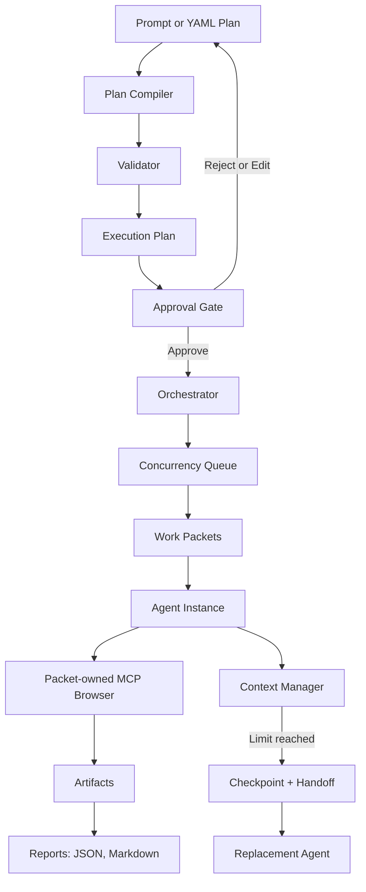

# BrowserSwarm

A local-first, model-agnostic web testing framework. Describe what to test in plain language or YAML, and
BrowserSwarm compiles it into deterministic browser scenarios, splits them into work packets for parallel
browser agents, shows you the full execution plan, and **runs only after you approve it**.

> **Authorization required.** Only test sites you own or are authorized to test. Destructive actions are blocked
> by default, and BrowserSwarm never solves CAPTCHAs or bypasses auth, rate limits or other security controls.
> See [docs/safety.md](docs/safety.md).

## Highlights

- **Plan-driven:** your plan is the scope. Agents execute approved packets and never add scenarios or relax policy.
- **Approval-first:** nothing starts until an approval is bound to the exact, hashed plan. Any change invalidates it.
- **Guarded browser access:** every action goes through a gateway to a packet-owned
  [Playwright MCP](https://github.com/microsoft/playwright-mcp) server with domain allowlists, budgets and redaction.
- **Deterministic by default:** scripted steps run with zero LLM calls. Agentic mode (OpenRouter) is optional and
  can only pass with captured evidence.
- **Context-resilient:** when an agent nears its context or budget limit, it checkpoints and writes a structured
  handoff so a fresh agent can continue the same packet.
- **Evidence-based:** every finding includes screenshots, URLs, redacted DOM, and console and network logs.

## Run modes

- **Instruction-led:** your prompt or plan lists scenarios and steps, and they are never broadened.
- **Autonomous:** give only a URL. A read-only Discovery Agent maps the site, proposes a test plan, and waits for
  approval. See [docs/autonomous-mode.md](docs/autonomous-mode.md).

## Architecture



Full details: [docs/architecture.md](docs/architecture.md).

## Quick start

Requirements: Node.js 20+, pnpm 10.

```bash
pnpm install
# Install the Chromium matching the Playwright bundled with @playwright/mcp
node "$(dirname "$(pnpm --filter @browserswarm/mcp-browser exec node -p 'require.resolve("playwright/package.json",{paths:[require.resolve("@playwright/mcp/package.json")]})')")/cli.js" install chromium
pnpm build
cp .env.example .env   # set BROWSERSWARM_TARGET_URL and optional LLM keys
```

Run against the local fixture site:

```bash
pnpm fixture:serve   # in .env: BROWSERSWARM_TARGET_URL=http://127.0.0.1:4173

pnpm browserswarm validate --plan examples/login-validation/compiled-plan.yaml
pnpm browserswarm preview  --plan examples/login-validation/compiled-plan.yaml --parallel 4 --write plans/execution-plan.json
pnpm browserswarm approve  --plan examples/login-validation/compiled-plan.yaml --execution-plan plans/execution-plan.json
pnpm browserswarm run      --approved-plan plans/approved-execution-plan.json --output artifacts/run-001
```

Or start from a URL or a natural-language prompt:

```bash
pnpm browserswarm run --url https://staging.example.com                        # autonomous
pnpm browserswarm run --prompt ./testing-request.md --parallel 4               # instruction-led
pnpm browserswarm plan --prompt ./testing-request.md --output plans/compiled-plan.yaml
```

For CI, `--yes` records a noninteractive approval and refuses plans with risky steps unless you pass
`--accept-risk --risk-plan-hash <hash>`.

## Documentation

| Topic                          | Doc                                                                                                      |
| ------------------------------ | -------------------------------------------------------------------------------------------------------- |
| Configuration (`.env`)         | [docs/configuration.md](docs/configuration.md)                                                           |
| Plan format and prompt grammar | [docs/test-plan-format.md](docs/test-plan-format.md)                                                     |
| Approval and risk approval     | [docs/approval-flow.md](docs/approval-flow.md)                                                           |
| Context lifecycle and handoffs | [docs/context-lifecycle.md](docs/context-lifecycle.md), [docs/handoff-format.md](docs/handoff-format.md) |
| Reports and artifacts          | [docs/reports.md](docs/reports.md)                                                                       |
| OpenCode support               | [docs/opencode.md](docs/opencode.md)                                                                     |
| Troubleshooting                | [docs/troubleshooting.md](docs/troubleshooting.md)                                                       |

## Status

| Area                                                              | Status                                                      |
| ----------------------------------------------------------------- | ----------------------------------------------------------- |
| Approval-first deterministic core, checkpoints, handoffs, reports | Implemented                                                 |
| Autonomous discovery mode                                         | Implemented                                                 |
| Guarded Playwright MCP execution, Chrome/Chromium matrix, replay  | Implemented                                                 |
| OpenRouter agentic execution and verifier packets                 | Implemented (OpenCode blocked pending verifiable isolation) |
| Automatic replacement agents                                      | Planned (interfaces in place)                               |
| Accessibility (axe) and overflow checks, HTML/JUnit reports       | Deferred                                                    |
| Dashboard UI                                                      | Planned                                                     |

## Development

```bash
pnpm lint        # eslint + prettier
pnpm typecheck
pnpm test        # unit + integration (real Chromium via Playwright MCP)
pnpm build
```
